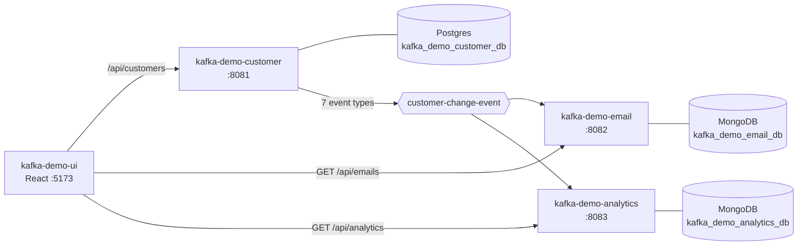

# Architecture

## The Kafka Demo system

| Repo | Role | Port | Data store |
|---|---|---|---|
| kafka-demo-customer | Owns customers and phones, publishes `customer-change-event` | 8081 | Postgres |
| kafka-demo-email | Sends an email for each customer change | 8082 | MongoDB |
| kafka-demo-analytics | Saves every event on `customer-change-event` | 8083 | MongoDB |
| kafka-demo-ui | React UI over all three | 5173 | — |
| local-docker | Kafka, Postgres, MongoDB, Keycloak for local dev | — | — |

## The UI

Opening the app goes straight to the Keycloak sign-in page (authorization code with PKCE), styled by the `kafka-demo`
login theme in `local-docker/keycloak/themes`. After sign-in come tabs: Customers and Analytics for everyone, and a
paged, filterable list of sent emails for `customer-admin`. Hiding a control is for convenience only; the services
enforce every role. Tokens are kept in memory only (`src/auth/session.js`).

The customer list is a table that becomes stacked cards on narrow screens. Details, the add and edit forms open in a side
drawer, deletes ask in a confirmation dialog, and results show as toasts. Each event type keeps one colour wherever it
appears (`src/eventTypes.js`, `--series-*` in `index.css`), always next to its name, so colour is never the only cue.

- `App.jsx` loads data with `usePolling` (every 3 s). Polling is deliberate: email and analytics are
  updated asynchronously from Kafka, so a refresh right after creating a customer would miss them.
- `api/client.js` is the only module that talks HTTP. Errors are turned into `Error(message)` using the
  services' `ProblemDetail.detail` when present.
- Each card handles its own loading, empty and error states, so one service being down doesn't blank the page.

## Routing to services

| Path prefix | Dev (Vite proxy) | Container (nginx) |
|---|---|---|
| `/api/customers` | `localhost:8081` | `host.docker.internal:8081` |
| `/api/emails` | `localhost:8082` | `host.docker.internal:8082` |
| `/api/analytics` | `localhost:8083` | `host.docker.internal:8083` |

The browser only ever talks to one origin, so the services need no CORS config.

## Known gaps

- No client-side routing; one page.
- Polling instead of server push (SSE/WebSocket).
- nginx upstreams are hard-coded for local use.
